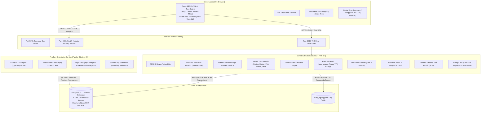
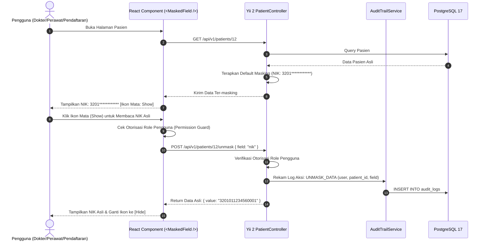
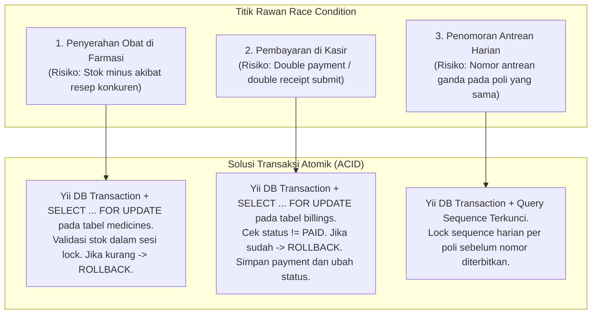

# Desain Arsitektur Sistem: SIMRS Pelayanan Rawat Jalan Terintegrasi (Revisi v2.1)

Dokumen ini mendokumentasikan spesifikasi arsitektur teknis menyeluruh dari aplikasi **SIMRS (Sistem Informasi Manajemen Rumah Sakit)** sesuai dengan standar rekayasa perangkat lunak modern:
- **Frontend**: Mengikuti panduan performa **`/vercel-react-best-practices`**, *Inline Field Error Architecture*, dan *Global Error Boundary*.
- **Backend Utama SIMRS**: Mengikuti panduan arsitektur **`/yii2-core`** dengan *Audit Trail Behavior*, *Sanitized Log Pipeline*, dan *Data Masking Engine*.
- **Backend Services / API**: Mengikuti panduan arsitektur **`/nodejs-best-practices`** (Fastify + TypeScript di folder `services/ancillary-service`).
- **Basis Data Relasional**: Mengikuti panduan optimasi kueri dan indeks **`/postgresql-optimization`** serta *Append-Only Immutability* untuk audit log.
- **Kepatuhan Privasi**: Prinsip *Privacy by Default* & *Traceability* sesuai **UU No. 27 Tahun 2022 tentang Pelindungan Data Pribadi (UU PDP)**.

---

## 1. Diagram Arsitektur Komponen Sistem



---

## 2. Arsitektur Audit Trail & Pelindungan Data Pribadi (UU PDP)

### 2.1 Arsitektur Audit Trail (Sanitized & Immutable)
Untuk memenuhi ketentuan UU PDP No. 27/2022 dan standar ISO 27001, audit log diimplementasikan dengan prinsip:
1. **Pencatatan Otomatis via Behavior**:
   * Komponen `app\behaviors\AuditTrailBehavior` dipasang pada seluruh model transaksional dan master data.
   * Merekam aktivitas: `LOGIN`, `LOGOUT`, `CREATE`, `UPDATE`, `DELETE`, `UNMASK_DATA`, `DISPENSE`, `PAYMENT`.
2. **Pembersihan Data Sensitif (Sanitization Pipeline)**:
   * Sebelum data disimpan ke kolom `details` (JSONB) pada tabel `audit_logs`, seluruh field sensitif disaring secara otomatis:
     ```php
     private static array $blacklistedFields = [
         'password', 'password_hash', 'auth_key', 'access_token', 'token', 'secret'
     ];
     ```
   * Nilai field di atas diabaikan atau diganti dengan `'[REDACTED]'`.
3. **Ketahanan terhadap Manipulasi (Tamper-Proof Design)**:
   * Tabel `audit_logs` hanya memiliki operasi `INSERT` dan `SELECT`.
   * Model `AuditLog` di Yii 2 tidak menyediakan action `update` maupun `delete`.
   * Akses kueri audit trail dibatasi secara ketat hanya untuk pengguna dengan role `admin`.

### 2.2 Pola Arsitektur Data Masking & Unmasking Interaktif
Data pribadi pasien dilindungi secara *default* dari pandangan umum (*Privacy by Default*):



---

## 3. Arsitektur Form Validation & Error Handling

### 3.1 Pipa Alur Validasi Form (Field-Level Error Mapping)
Mekanisme validasi distandarisasi untuk memberikan *User Experience* (UX) yang jelas dan mempertahankan data input pengguna:

1. **Frontend Client Validation**:
   * Validasi lokal (misal format NIK 16 digit, angka tensi darah wajar) dievaluasi saat *blur* atau *submit*.
   * State form memisahkan nilai input (`values`) dan pesan kesalahan (`fieldErrors`):
     ```typescript
     interface FormState<T> {
       values: T;
       fieldErrors: Partial<Record<keyof T, string>>;
       isSubmitting: boolean;
     }
     ```
   * Ketika terjadi validasi error, nilai `values` **tetap dipertahankan** di dalam state, sehingga pengguna tidak perlu mengisi ulang form.
2. **Backend 422 Validation Error Mapping**:
   * Jika validasi sisi server di Yii2 gagal (`$model->validate() == false`), backend mengembalikan HTTP 422 (*Unprocessable Entity*):
     ```json
     {
       "success": false,
       "message": "Validasi input pendaftaran gagal",
       "errors": {
         "nik": ["Nomor Induk Kependudukan (NIK) harus terdiri dari 16 digit angka."],
         "phone": ["Nomor telepon hanya boleh memuat digit angka."]
       }
     }
     ```
   * Fungsi `apiClient` menangkap error berstatus 422 dan mengubahnya menjadi instans `ValidationError` yang berisi dictionary `errors`.
   * Hook form secara otomatis memetakan key error backend ke `fieldErrors` di UI.
3. **Visual & Accessibility State**:
   * Field input yang salah menerima class CSS error, border merah (`var(--color-danger)`), atribut `aria-invalid="true"`, dan pesan bantuan tepat di bawah elemen input:
     ```html
     <div class="form-field-group">
       <label for="patient-nik">NIK Pasien</label>
       <input 
         id="patient-nik" 
         aria-invalid="true" 
         aria-describedby="patient-nik-error" 
         class="form-input form-input--error" 
       />
       <span id="patient-nik-error" class="form-error-text" role="alert">
         Nomor Induk Kependudukan (NIK) harus terdiri dari 16 digit angka.
       </span>
     </div>
     ```

### 3.2 Penanganan Error Global (Global Error Architecture)
Modal dialog / popup terpusat hanya aktif untuk kesalahan sistemik tak terduga (*non-field errors*):

| Jenis Kesalahan | HTTP Code | Komponen Penangan | Pesan Dialog Pengguna |
|---|---|---|---|
| **Server Error** | 500 | `GlobalErrorModal` | "Terjadi kesalahan internal pada server. Tim teknis sedang menanganinya." |
| **Koneksi Terputus** | Network | `NetworkBanner` / `Modal` | "Koneksi ke server terputus. Mohon periksa jaringan internet Anda." |
| **Sesi Habis / Token Invalid** | 401 | `SessionExpiredModal` | "Sesi Anda telah berakhir demi keamanan. Silakan login kembali." $\to$ [Tombol Login] |
| **Akses Ditolak** | 403 | `AccessDeniedModal` | "Akses Ditolak. Anda tidak memiliki izin untuk melakukan tindakan ini." |
| **Validation Error Biasa** | 422 | *Inline Field Form (No Modal!)* | Pesan error dirender tepat di bawah masing-masing input terkait. |

---

## 4. Pola Database PostgreSQL 17: Audit Logs & Composite Indexing

### 4.1 Skema Tabel `audit_logs` (Append-Only)
```sql
CREATE TABLE audit_logs (
    id BIGSERIAL PRIMARY KEY,
    user_id INT REFERENCES users(id) ON DELETE SET NULL,
    username VARCHAR(50) NOT NULL,
    user_role VARCHAR(30) NOT NULL,
    action VARCHAR(50) NOT NULL CHECK (action IN ('LOGIN', 'LOGOUT', 'CREATE', 'UPDATE', 'DELETE', 'UNMASK_DATA', 'DISPENSE', 'PAYMENT')),
    module VARCHAR(50) NOT NULL CHECK (module IN ('AUTH', 'PATIENTS', 'REGISTRATIONS', 'NURSE_ASSESSMENT', 'EXAMINATIONS', 'PHARMACY', 'LABORATORY', 'BILLING', 'USERS')),
    resource_id VARCHAR(50),
    ip_address VARCHAR(45),
    user_agent VARCHAR(255),
    details JSONB,
    created_at TIMESTAMP DEFAULT CURRENT_TIMESTAMP NOT NULL
);

-- Indeks performa tinggi untuk pencarian audit trail
CREATE INDEX idx_audit_logs_user_date ON audit_logs(user_id, created_at DESC);
CREATE INDEX idx_audit_logs_module_action ON audit_logs(module, action);
CREATE INDEX idx_audit_logs_created_at ON audit_logs(created_at DESC);
```

---

## 5. Mekanisme Transaksi Kritis & Kode Transaksi Atomik (ACID)

Sistem mengidentifikasi 3 titik kritis yang berisiko mengalami *race condition* dan menerapkan mitigasi berbasis database transaction dengan *row-level locking*:



### 5.1 Implementasi Transaksi Atomik Mutasi Stok Farmasi
```php
public function dispense(int $prescriptionId, int $userId): bool
{
    $transaction = Yii::$app->db->beginTransaction();
    try {
        $prescription = Prescription::findOne($prescriptionId);
        if (!$prescription || $prescription->status !== 'PENDING') {
            throw new UnprocessableEntityHttpException('Resep tidak valid atau sudah diserahkan.');
        }

        foreach ($prescription->items as $item) {
            // Lock baris obat secara eksklusif untuk mencegah modifikasi konkuren
            $medicine = Medicine::find()
                ->where(['id' => $item->medicine_id])
                ->forUpdate()
                ->one();

            if ($medicine->stock < $item->quantity) {
                throw new UnprocessableEntityHttpException(
                    "Stok obat {$medicine->name} tidak mencukupi (Tersisa: {$medicine->stock}, Diminta: {$item->quantity})."
                );
            }

            // Kurangi stok
            $medicine->stock -= $item->quantity;
            $medicine->save(false);

            // Simpan audit log mutasi stok
            $log = new MedicineStockLog([
                'medicine_id' => $medicine->id,
                'transaction_type' => 'OUT',
                'quantity' => $item->quantity,
                'balance_after' => $medicine->stock,
                'reference_type' => 'PRESCRIPTION',
                'reference_id' => $prescription->id,
                'notes' => "Penyerahan resep {$prescription->prescription_number}",
            ]);
            $log->save(false);
        }

        $prescription->status = 'DISPENSED';
        $prescription->dispensed_at = date('Y-m-d H:i:s');
        $prescription->dispensed_by = $userId;
        $prescription->save(false);

        // Update tagihan obat di billing
        Billing::recalculate($prescription->registration_id);

        $transaction->commit();
        return true;
    } catch (\Throwable $e) {
        $transaction->rollBack();
        throw $e;
    }
}
```

### 5.2 Implementasi Transaksi Atomik Pembayaran Kasir
```php
public function processPayment(int $billingId, string $method, float $receivedAmount, int $cashierId): array
{
    $transaction = Yii::$app->db->beginTransaction();
    try {
        // Lock baris billing untuk mencegah proses pembayaran paralel ganda
        $billing = Billing::find()
            ->where(['id' => $billingId])
            ->forUpdate()
            ->one();

        if (!$billing) {
            throw new NotFoundHttpException('Data tagihan tidak ditemukan.');
        }

        if ($billing->payment_status === 'PAID') {
            throw new UnprocessableEntityHttpException('Tagihan ini sudah lunas dibayar sebelumnya.');
        }

        if ($method === 'BPJS') {
            // Skenario BPJS: Bebas out-of-pocket, tagihan ditanggung penuh oleh BPJS
            $billing->covered_by_bpjs = $billing->total_amount;
            $billing->patient_payable = 0.00;
            $billing->payment_status = 'PAID';
            $billing->save(false);

            $payment = new BillingPayment([
                'billing_id' => $billing->id,
                'payment_number' => 'PAY-BPJS-' . date('Ymd') . '-' . sprintf('%04d', $billing->id),
                'payment_method' => 'BPJS',
                'amount' => 0.00,
                'amount_received' => 0.00,
                'change_amount' => 0.00,
                'cashier_id' => $cashierId,
                'notes' => 'Lunas ditanggung penuh oleh BPJS Kesehatan',
            ]);
            $payment->save(false);
        } else {
            // Skenario Tunai: Full payment
            if ($receivedAmount < $billing->total_amount) {
                throw new UnprocessableEntityHttpException('Uang yang diterima kurang dari total tagihan.');
            }

            $change = $receivedAmount - $billing->total_amount;
            $billing->patient_payable = $billing->total_amount;
            $billing->payment_status = 'PAID';
            $billing->save(false);

            $payment = new BillingPayment([
                'billing_id' => $billing->id,
                'payment_number' => 'PAY-CASH-' . date('Ymd') . '-' . sprintf('%04d', $billing->id),
                'payment_method' => 'CASH',
                'amount' => $billing->total_amount,
                'amount_received' => $receivedAmount,
                'change_amount' => $change,
                'cashier_id' => $cashierId,
                'notes' => 'Pembayaran lunas tunai (Full Payment)',
            ]);
            $payment->save(false);
        }

        // Tandai status kunjungan pasien selesai (COMPLETED)
        $registration = Registration::findOne($billing->registration_id);
        if ($registration) {
            $registration->status = 'COMPLETED';
            $registration->save(false);
        }

        $transaction->commit();
        return [
            'billing' => $billing,
            'payment' => $payment,
        ];
    } catch (\Throwable $e) {
        $transaction->rollBack();
        throw $e;
    }
}
```

---

## 6. Topologi Layanan Docker & Jaringan

```yaml
services:
  backend:
    build:
      context: ./backend
      dockerfile: Dockerfile
    container_name: yii2-backend
    ports:
      - "8080:80"
    depends_on:
      postgres:
        condition: service_healthy
    networks:
      - app-network

  services:
    build:
      context: ./services/ancillary-service
      dockerfile: Dockerfile
    container_name: nodejs-ancillary-service
    ports:
      - "4000:4000"
    depends_on:
      postgres:
        condition: service_healthy
    networks:
      - app-network

  frontend:
    build:
      context: ./frontend
      dockerfile: Dockerfile
    container_name: react19-frontend
    ports:
      - "5173:5173"
    depends_on:
      - backend
      - services
    networks:
      - app-network

  postgres:
    image: postgres:17
    container_name: postgres17-database
    ports:
      - "127.0.0.1:5432:5432"
    networks:
      - app-network
```

---

## 7. Ringkasan Kepatuhan Standar Rekayasa

1. **Prinsip `/nodejs-best-practices`**:
   * Layanan Fastify di `services/ancillary-service` memisahkan routing, schema Zod, controller, dan repositori database pool.
2. **Prinsip `/vercel-react-best-practices`**:
   * Penanganan state form mempertahankan nilai input pengguna saat validasi gagal (*controlled inputs without re-render cascades*).
   * Direct imports komponen Astryx tanpa barrel file overhead.
   * Modal dialog global hanya dipicu untuk error 500, network, 401, dan 403.
3. **Prinsip `/yii2-core`**:
   * Thin controllers, implementasi `AuditTrailBehavior` pada level model, validasi data via `Model::validate()`, penanganan error terpusat via JSON serializer.
4. **Prinsip `/postgresql-optimization`**:
   * Seluruh foreign key terindeks B-Tree, composite index pada antrean harian dan log audit, row locking `FOR UPDATE` pada mutasi stok dan kasir.
