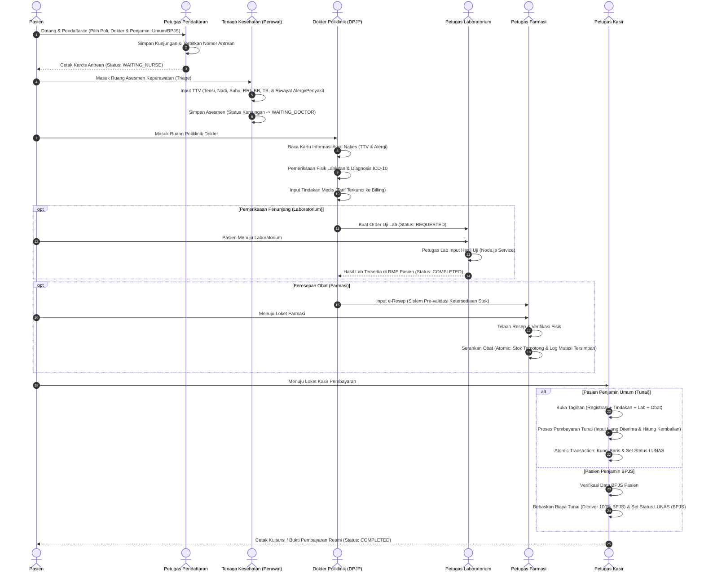
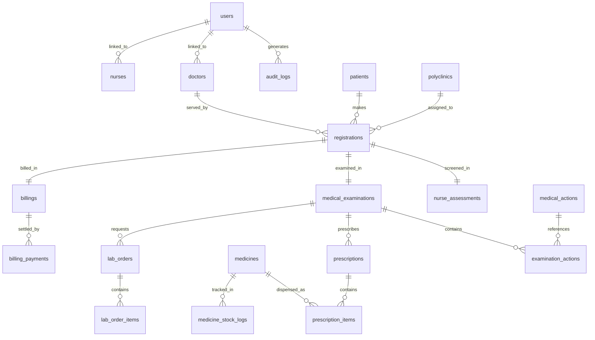

# Spesifikasi Kebutuhan Sistem: SIMRS Pelayanan Rawat Jalan Terintegrasi (Lengkap & Terpadu)

Dokumen ini merupakan spesifikasi formal pengembangan **Sistem Informasi Manajemen Rumah Sakit (SIMRS)** untuk mengelola seluruh siklus pelayanan rawat jalan pasien, mulai dari pendaftaran pasien, skrining awal keperawatan (triage nakes), pemeriksaan klinis dokter poliklinik, tindakan medis, e-resep farmasi dengan mutasi stok atomik, pemeriksaan penunjang (laboratorium) via service Node.js, billing kasir (Cash Full Payment atau Ditanggung BPJS), modul pelaporan dashboard, serta **Modul Audit Trail & Data Masking (Kepatuhan UU No. 27 Tahun 2022 tentang Pelindungan Data Pribadi / UU PDP)** dan **Standarisasi Form Validation & Global Error Handling**.

---

## 1. Ringkasan Kasus & Tujuan Sistem

### 1.1 Latar Belakang & Filosofi Pelayanan
Pelayanan rawat jalan modern menuntut standarisasi klinis, integritas transaksi, dan pelindungan data pribadi pasien yang ketat:
1. **Integrasi End-to-End**: Menghubungkan seluruh proses pelayanan rawat jalan dalam satu alur data terpadu tanpa redundansi input.
2. **Skrining Awal Keperawatan (Triage/Asesmen Nakes)**: Pasien yang selesai mendaftar diperiksa terlebih dahulu oleh Tenaga Kesehatan (Perawat) untuk mengukur tanda-tanda vital (TTV), antropometri, dan skrining riwayat alergi/penyakit sebagai data awal dasar sebelum dokter melakukan konsultasi.
3. **Klinis Terpadu Dokter (DPJP)**: Dokter poliklinik menerima pasien dengan data awal nakes yang sudah lengkap, sehingga konsultasi lebih cepat, akurat, dan terarah pada pemeriksaan fisik mendalam serta penegakan diagnosis (ICD-10).
4. **Integritas Transaksi Atomik (ACID)**: Titik rawan *race condition* seperti pengurangan stok obat di farmasi dan pencatatan pembayaran kasir dilindungi dengan transaksi database atomik (*row-level locking `SELECT ... FOR UPDATE`*) untuk menjamin konsistensi data.
5. **Skema Pembayaran Jelas & Tegas**: Kasir hanya melayani dua model pembayaran:
   * **Tunai (Cash - Full Payment)**: Pembayaran lunas penuh dengan perhitungan nominal uang diterima dan kembalian otomatis.
   * **BPJS Kesehatan**: Pasien peserta BPJS mendapatkan pembebasan biaya tunai (*Rp 0 out-of-pocket*), tagihan langsung berstatus LUNAS dicover BPJS. Tidak ada skema cicilan atau pembayaran tertunda.
6. **Pelindungan Data Pribadi & Audit Trail (UU PDP No. 27/2022)**:
   * Seluruh data identitas pribadi sensitif pasien disamarkan secara default (*masked*).
   * Fitur *Show/Hide* interaktif untuk melihat data asli (*unmasking*) hanya dapat diakses oleh role yang memiliki otorisasi, dan setiap aktivitas unmasking wajib dicatat ke dalam audit trail.
   * Modul Audit Trail merekam seluruh aktivitas penting pengguna (login, logout, create, update, delete, dan unmask) secara permanen tanpa menyimpan kredensial atau password plaintext.
7. **Standarisasi Validasi Form & Error Handling**:
   * Error validasi (frontend maupun 422 API backend) wajib dipetakan ke field terkait dan ditampilkan tepat di bawah field input.
   * Nilai input pengguna dipertahankan (*preserved*) saat error validasi terjadi.
   * Dialog/popup modal hanya digunakan untuk error global sistemik (500, network error, 401 session expired, 403 forbidden).
8. **Standar Bahasa Konsisten**:
   * **Antarmuka Pengguna (UI) & Pesan Respon API**: 100% Bahasa Indonesia yang komunikatif dan ramah pengguna klinis/administratif.
   * **Kode Sumber & Struktur Data**: 100% Bahasa Inggris baku (*clean code, camelCase / snake_case, standard naming*).

---

## 2. Arsitektur Teknologi & Batasan Teknis

| Komponen | Pilihan Teknologi | Standar / Panduan Kepatuhan |
|---|---|---|
| **Frontend Application** | React.js 19 + TypeScript + Vite | Mengikuti `/vercel-react-best-practices`, *Astryx Design System* (Meta), dan Inline Field Validation |
| **Backend Utama (SIMRS)** | Yii 2 Framework (PHP 8.4) | Mengikuti `/yii2-core`, Active Record ACID, Bearer Auth, Sanitized Audit Trail Behavior |
| **Backend Services / API** | Node.js 22 (Fastify + TypeScript) | Mengikuti `/nodejs-best-practices` (Layered architecture, Zod validation, pg.Pool) di folder `services/ancillary-service` |
| **Database** | PostgreSQL 17 | Mengikuti `/postgresql-optimization` (Composite indexes, foreign key indexing, row-level locks, audit log immutability) |
| **Containerization** | Docker & Docker Compose | Dockerfile terpisah untuk Frontend, Backend Yii2, dan Node.js Fastify Service |
| **Kepatuhan Regulasi** | UU No. 27 Tahun 2022 (UU PDP) | Data Masking default, Access Control Unmasking, Immutable Audit Trail |

---

## 3. Matriks Hak Akses Pengguna (RBAC Matrix - 7 Peran)

| Modul / Fitur | Admin | Pendaftaran | Nakes / Perawat | Dokter | Farmasi | Lab | Kasir |
|---|:---:|:---:|:---:|:---:|:---:|:---:|:---:|
| **Manajemen Pengguna & Hak Akses** | Full (CRUD) | - | - | - | - | - | - |
| **Lihat Audit Trail Lengkap** | Full (Read) | - | - | - | - | - | - |
| **Akses Unmask Data Pasien (NIK/Telp)** | Full | Full (Verifikasi) | Full (Klinis) | Full (Klinis) | Read Resep | Read Sampel | Read Tagihan |
| **Master Data (Dokter, Poli, Jadwal)** | Full (CRUD) | Read | Read | Read | Read | - | Read |
| **Master Data Pasien** | Full (CRUD) | Full (CRUD) | Read | Read | Read | Read | Read |
| **Master Tindakan Medis & Tarif** | Full (CRUD) | Read | Read | Read | - | Read | Read |
| **Master Obat, Stok, & Harga** | Full (CRUD) | - | - | Read Stok | Full (CRUD) | - | Read Harga |
| **Pendaftaran Kunjungan & Antrean** | Read | Full (Create, Print) | Read Antrean | Read Antrean | - | - | Read Status |
| **Asesmen Awal Nakes (TTV & Alergi)** | Read | - | Full (Create/Edit) | Read Hasil | - | - | - |
| **RME Dokter (Diagnosis ICD-10 & Fisik)** | Read | - | Read | Full (Create/Edit) | - | Read Terkait | - |
| **Input Tindakan Medis Pasien** | Read | - | - | Full (Create) | - | - | Read Tagihan |
| **Input e-Resep Pasien** | Read | - | - | Full (Create) | Read Resep | - | - |
| **Telaah & Penyerahan Obat (Dispensing)** | Read | - | - | - | Full (Atomic Update) | - | Read Status |
| **Permintaan Uji Laboratorium** | Read | - | - | Full (Create) | - | Read Antrean | - |
| **Input Hasil Uji Laboratorium** | Read | - | - | Read Hasil | - | Full (Create/Edit) | - |
| **Kasir Pembayaran (Cash / BPJS)** | Read Audit | Read Status | - | - | Read Status | Read Status | Full (Pay, Invoice) |
| **Dashboard Operasional & Laporan** | Full | Kunjungan | - | Kinerja Poli | Stok & Mutasi | Beban Uji | Pendapatan |

---

## 4. Alur Bisnis Pelayanan Rawat Jalan Terintegrasi



---

## 5. Rincian Kebutuhan Fungsional Lengkap per Modul (Modul 1 s/d 9)

### Modul 1: Pengelolaan Master Data (Yii 2 Backend)
1. **Master Pasien**:
   * Nomor Rekam Medis (auto-generated `RM-YYYYMM-XXXXX` unik permanen).
   * NIK (wajib 16 digit angka unik, pencegahan duplikasi data).
   * Data identitas: Nama Lengkap, Tanggal Lahir, Jenis Kelamin (`L`/`P`), Alamat, No Telepon, No BPJS (opsional).
   * Seluruh data identitas pasien ditampilkan tersamar (*masked*) secara default.
2. **Master Dokter & Tenaga Medis**:
   * Data Dokter: NIP/SIP unik, Nama Lengkap beserta gelar, Spesialisasi, No Telepon, Tautan Akun User.
   * Data Nakes/Perawat: NIP unik, Nama Lengkap, Unit Poliklinik, Tautan Akun User.
3. **Master Poliklinik / Unit Pelayanan**:
   * Kode Poli unik (misal: `POL-DALAM`, `POL-ANAK`, `POL-UMUM`), Nama Poliklinik, Deskripsi, Status Aktif.
4. **Master Jadwal Praktik Dokter**:
   * Relasi: Dokter + Poliklinik + Hari (`Senin`-`Minggu`) + Jam Mulai + Jam Selesai + Kuota Maksimal Pasien.
   * **Pencegahan Bentrok**: Validasi backend menolak jika dokter dijadwalkan pada hari dan rentang jam yang bertabrakan di poliklinik mana pun.
5. **Master Tindakan Medis & Tarif**:
   * Kode Tindakan unik, Nama Tindakan, Kategori (Konsultasi, Tindakan Ringan, Tindakan Diagnostik), Tarif (Rupiah), Status Aktif.
6. **Master Obat, Stok, & Harga**:
   * Kode Obat unik, Nama Obat, Kategori/Golongan, Satuan (Tablet, Botol, Ampul), Stok Saat Ini, Stok Minimum, Harga Satuan.
   * **Audit Mutasi Stok**: Setiap perubahan stok dicatat di tabel `medicine_stock_logs` (`IN`, `OUT`, `ADJUSTMENT`).

### Modul 2: Pendaftaran & Antrean Pasien (Yii 2 & React.js)
1. **Pencarian Pasien Cepat**: Berdasarkan No Rekam Medis, NIK, atau Nama Pasien (debounce query).
2. **Form Pendaftaran Kunjungan**:
   * Pemilihan Poliklinik dan Dokter sesuai jadwal praktik aktif pada hari berjalan.
   * Pemilihan Penjamin: `GENERAL` (Pasien Umum/Tunai) atau `BPJS` (Pasien BPJS Kesehatan).
   * Pengecekan kuota antrean dokter harian.
3. **Nomor Antrean Otomatis**:
   * Format nomor antrean: `<KodePoli>-<NomorUrut3Digit>` (contoh: `INT-001`, `ANK-002`).
   * Reset urutan nomor antrean menjadi 1 setiap pergantian tanggal kalender per poliklinik.
4. **Manajemen Status Antrean Pasien**:
   * `WAITING_NURSE` (Menunggu Skrining Nakes) $\to$ `IN_NURSE` (Sedang Diperiksa Nakes) $\to$ `WAITING_DOCTOR` (Menunggu Dokter Poli) $\to$ `IN_DOCTOR` (Sedang Diperiksa Dokter) $\to$ `PHARMACY` (Menunggu Obat) $\to$ `BILLING` (Menunggu Pembayaran Kasir) $\to$ `COMPLETED` (Selesai).
5. **Riwayat Kunjungan Pasien**: Menampilkan riwayat pendaftaran sebelumnya.

### Modul 2.5: Skrining & Asesmen Awal Keperawatan (Yii 2 & React.js)
1. Perawat memanggil antrean pasien berstatus `WAITING_NURSE` ke ruang triage/asesmen.
2. Input data fisik & antropometri:
   * Umur & Jenis Kelamin (terbaca otomatis, dapat dikonfirmasi).
   * Berat Badan (kg) & Tinggi Badan (cm).
   * Tanda-tanda Vital (TTV): Tensi Darah Sistolik / Diastolik (mmHg), Frekuensi Nadi (x/mnt), Suhu Tubuh (°C), Pernapasan (x/mnt).
3. Input anamnesis awal keperawatan:
   * Keluhan Utama saat datang.
   * Riwayat Alergi (Alergi Obat, Alergi Makanan, Riwayat Reaksi Berat).
   * Riwayat Penyakit (Hipertensi, Diabetes Melitus, Asma, dsb).
   * Catatan Khusus Perawat.
4. Simpan Asesmen: Mengubah status kunjungan menjadi `WAITING_DOCTOR` sehingga langsung muncul di daftar tunggu dokter poliklinik.

### Modul 3: Pemeriksaan Klinis & Rekam Medis Dokter (Yii 2 & React.js)
1. Dokter poliklinik membuka antrean pasien berstatus `WAITING_DOCTOR`.
2. Sistem otomatis menampilkan **Kartu Informasi Awal Nakes** (TTV, BB/TB, Keluhan, Alergi) di bagian atas layar.
3. Dokter melengkapi catatan SOAP:
   * *Subjective*: Anamnesis mendalam & keluhan tambahan.
   * *Objective*: Pemeriksaan fisik spesifik dokter (Kepala, Leher, Thorax, Abdomen, Ekstremitas).
   * *Assessment*: Diagnosis Utama ICD-10 (Kode & Deskripsi) dan Diagnosis Sekunder.
   * *Plan*: Terapi, tindakan medis, e-resep, atau permintaan laboratorium.
4. Akses Riwayat RME: Dokter dapat membuka riwayat RME kunjungan masa lalu pasien.

### Modul 4: Pengelolaan Tindakan Medis (Yii 2 & React.js)
1. Dokter dapat memilih satu atau lebih tindakan medis dari Master Tindakan.
2. Sistem otomatis mengunci tarif tindakan sesuai master pada saat transaksi disimpan.
3. Rincian tindakan tercatat otomatis sebagai komponen tagihan billing kunjungan terkait.

### Modul 5: Farmasi & Resep Obat (Yii 2 & React.js)
1. **Pembuatan e-Resep Dokter**:
   * Dokter memilih obat, memasukkan jumlah, dosis, dan frekuensi aturan pakai (misal: `3x1 tablet sesudah makan`).
   * Sistem melakukan **pre-validasi stok obat real-time**; jika stok kurang, permintaan ditolak dengan pesan informatif Bahasa Indonesia.
2. **Telaah & Penyerahan Obat (Dispensing)**:
   * Petugas farmasi memeriksa fisik obat dan menekan tombol "Serahkan Obat".
   * **Atomic Transaction**: Sistem mengunci baris stok obat (`FOR UPDATE`), memverifikasi saldo akhir, memotong stok, dan mencatat log mutasi stok obat secara otomatis. Biaya obat masuk ke tagihan billing.

### Modul 6: Pemeriksaan Penunjang Laboratorium (Fastify Node.js & React.js)
1. Dokter dapat membuat permintaan uji laboratorium (misal: Hematologi Lengkap, Gula Darah, Kolesterol).
2. Petugas laboratorium melihat antrean order pada antarmuka Lab Worklist.
3. Petugas menginput nilai hasil pengujian, rentang nilai rujukan normal, satuan, dan tanda status (`NORMAL` / `ABNORMAL`).
4. Layanan REST API berbasis **Node.js Fastify** di folder `services/ancillary-service` menangani penerimaan order lab dan sinkronisasi data ke PostgreSQL 17.
5. Dokter dapat langsung memantau hasil uji lab pada antarmuka RME rawat jalan.

### Modul 7: Billing & Kasir Pembayaran (Yii 2 & React.js)
1. **Konsolidasi Tagihan Otomatis**:
   * Sistem menghitung: Biaya Pendaftaran + Total Tindakan Medis + Total Obat + Total Uji Lab.
2. **Skema Pembayaran Sederhana & Pasti**:
   * **Tunai (Cash Full Payment)**: Pasien membayar penuh. Kasir memasukkan nominal uang yang diserahkan (`amountReceived`), sistem otomatis menghitung kembalian (`changeAmount`), mencatat transaksi, dan mengubah status menjadi `PAID`.
   * **BPJS Kesehatan**: Pasien dengan penjamin BPJS dibebaskan dari biaya tunai (*Rp 0 out-of-pocket*). Kasir mengonfirmasi klaim BPJS, sistem mencatat penjamin BPJS, dan status tagihan langsung menjadi `PAID`.
   * **Tidak Mendukung Cicilan/Parsial**: Tagihan langsung diselesaikan saat itu juga.
3. **Pencegahan Transaksi Ganda (Atomic Row Lock)**:
   * Sistem mengecek `SELECT * FROM billings WHERE id = :id FOR UPDATE`. Jika status sudah `PAID`, transaksi kedua ditolak untuk mencegah double submit/payment.
4. **Cetak Bukti Pembayaran**: Kuitansi dan Faktur Rincian Biaya siap cetak (*Print-Ready Layout*).

### Modul 8: Dashboard & Laporan Analitik (Fastify Node.js & React.js)
1. KPI Ringkasan: Total Kunjungan Hari Ini, Kunjungan per Poli, Total Pendapatan Tunai vs Klaim BPJS, Penggunaan Obat Terbanyak, Status Antrean.
2. Filter rentang tanggal fleksibel (Hari Ini, 7 Hari Terakhir, Bulan Ini, atau Rentang Kustom).
3. Penyedia API Analitik: Fastify Node.js Service mengeksekusi query agregasi terindeks di PostgreSQL 17.

### Modul 9: Pengelolaan Pengguna & Hak Akses (Yii 2 & React.js)
1. Autentikasi berbasis Bearer Token dengan hashing Bcrypt.
2. Otorisasi RBAC berbasis 7 role terpisah di backend (AccessControl) dan frontend (Route Guard).

---

## 6. Modul 10: Audit Trail & Pelindungan Data Pribadi (UU PDP No. 27/2022)

### 6.1 Prinsip Kepatuhan UU PDP
Sesuai amanat UU No. 27 Tahun 2022 tentang Pelindungan Data Pribadi:
1. **Privacy by Default**: Data pribadi sensitif pasien disamarkan secara default pada seluruh halaman, tabel, detail, kartu, dan form.
2. **Access Limitation**: Hanya petugas yang memiliki hak akses klinis/administrasi yang berwenang membuka data asli (*unmasking*).
3. **Traceability**: Setiap aktivitas pembukaan data asli (*unmasking*) wajib dicatat ke dalam audit trail.

### 6.2 Aturan Pola Masking (Masking Patterns)
| Field Data | Pola Penyamaran (Masked Format) | Contoh Data Asli | Contoh Tampilan Masked |
|---|---|---|---|
| **NIK** | 4 digit awal ditampilkan, sisa disamarkan | `3201011234560001` | `3201************` |
| **No. Telepon / HP** | 4 digit awal & 4 digit akhir ditampilkan | `081234567890` | `0812****7890` |
| **Alamat Pasien** | Nama jalan utama ditampilkan, nomor/RT/RW disamarkan | `Jl. Pajajaran No. 45 RT 02/05` | `Jl. Pajajaran No. **` |
| **Email Pasien** | Huruf pertama dan domain ditampilkan | `budi.santoso@gmail.com` | `b***@gmail.com` |
| **No. BPJS** | 4 digit awal & 4 digit akhir ditampilkan | `0001234567890` | `0001****7890` |

### 6.3 Komponen UI `<MaskedField />` & Alur Unmasking
1. Field sensitif dirender menggunakan komponen `<MaskedField />` dengan ikon **Show/Hide (Eye/EyeOff)**.
2. Ketika diklik oleh role yang berhak:
   * Frontend memanggil API `POST /api/v1/patients/{id}/unmask` dengan `{ "field": "nik" }`.
   * Backend mencatat audit log `UNMASK_DATA` dan mengembalikan nilai asli.
   * Ikon berganti menjadi **Hide** agar pengguna dapat menyamarkannya kembali secara manual.

### 6.4 Ruang Lingkup & Keamanan Audit Trail
1. **Aktivitas yang Dicatat**: `LOGIN`, `LOGOUT`, `CREATE`, `UPDATE`, `DELETE`, `UNMASK_DATA`, `DISPENSE`, `PAYMENT`.
2. **Informasi Log**: `user_id`, `username`, `user_role`, `action`, `module`, `resource_id`, `ip_address`, `user_agent`, `details` (JSONB), `created_at`.
3. **Sanitasi Kredensial**: Dilarang keras mencatat password, token, session key, atau rahasia otentikasi di dalam log. Field sensitif otomatis disaring menjadi `'[REDACTED]'`.
4. **Append-Only Immutability**: Tabel `audit_logs` tidak menyediakan operasi edit/hapus dan hanya dapat dilihat oleh Administrator.

---

## 7. Standarisasi Validasi Form & Penanganan Error

### 7.1 Validasi Form & Pesan Error Field-Level (Frontend & Backend)
1. **Penyajian Error Inline**:
   * Seluruh pesan error validasi wajib ditampilkan tepat di bawah masing-masing field input terkait (menggunakan elemen `<span className="form-error-text" role="alert">`).
   * Dilarang menggunakan toast atau modal popup untuk menampilkan validation error field biasa.
2. **Pemetaan Respons API 422 (Backend to Form Mapping)**:
   * Backend mengembalikan HTTP 422 (*Unprocessable Entity*) dengan struktur error per field:
     ```json
     {
       "success": false,
       "message": "Validasi input pendaftaran gagal",
       "errors": {
         "nik": ["Nomor Induk Kependudukan (NIK) harus terdiri dari 16 digit angka."],
         "birth_date": ["Tanggal lahir pasien wajib diisi."]
       }
     }
     ```
   * Frontend form handler mengekstrak `errors` dan memetakannya langsung ke state error masing-masing field form.
3. **Preservasi Nilai Input (Form State Persistence)**:
   * Ketika terjadi error validasi, nilai yang telah diketik pengguna **tidak boleh hilang atau ter-reset**. Pengguna hanya perlu memperbaiki field yang salah tanpa mengulang pengisian dari awal.
4. **Visual State Aksesibel**:
   * Field bermasalah diberi border merah tegas (`var(--color-danger)`), outline fokus merah, atribut `aria-invalid="true"`, dan `aria-describedby="{field}-error"`.

### 7.2 Penanganan Error Global (Global Error Handling)
Modal dialog atau alert popup terpusat **hanya** digunakan untuk kondisi kegagalan sistemik yang tidak dapat dikaitkan dengan field form tertentu:
1. **HTTP 500 (Internal Server Error)**: Dialog menginformasikan "Terjadi kesalahan pada server. Silakan hubungi administrator sistem."
2. **Network Error / Koneksi Terputus**: Banner/Modal "Koneksi internet terputus. Memeriksa kembali jaringan..."
3. **HTTP 401 (Unauthorized / Session Expired)**: Modal "Sesi Anda telah berakhir. Silakan login kembali untuk melanjutkan." dengan tombol redirect ke halaman login.
4. **HTTP 403 (Forbidden / Akses Ditolak)**: Dialog "Akses ditolak. Anda tidak memiliki kewenangan untuk mengakses fitur ini."
5. **Kegagalan Sistemik Tak Terduga**: Kegagalan transaksi yang tidak terkait langsung dengan input form.

---

## 8. Desain Skema Database Relasional (PostgreSQL 17 - 20 Tabel)



### 8.1 Kamus Tabel Lengkap

1. **`users`**: `id`, `username`, `password_hash`, `auth_key`, `access_token`, `full_name`, `role`, `is_active`, `created_at`, `updated_at`.
2. **`doctors`**: `id`, `user_id`, `nip`, `name`, `specialization`, `phone`, `sip_number`, `created_at`.
3. **`nurses`**: `id`, `user_id`, `nip`, `name`, `phone`, `created_at`.
4. **`audit_logs`**: `id`, `user_id`, `username`, `user_role`, `action`, `module`, `resource_id`, `ip_address`, `user_agent`, `details` (JSONB), `created_at` (Immutable Append-Only).
5. **`patients`**: `id`, `medical_record_number` (unique), `nik` (16 digit unique), `name`, `birth_date`, `gender`, `address`, `phone`, `bpjs_number`, `created_at`, `updated_at`.
6. **`polyclinics`**: `id`, `code` (unique), `name`, `description`, `is_active`, `created_at`.
7. **`doctor_schedules`**: `id`, `doctor_id`, `polyclinic_id`, `day_of_week`, `start_time`, `end_time`, `quota`, `is_active`.
8. **`medical_actions`**: `id`, `code` (unique), `name`, `category`, `tariff`, `is_active`.
9. **`medicines`**: `id`, `code` (unique), `name`, `category`, `unit`, `stock` (check >= 0), `min_stock`, `unit_price`, `is_active`.
10. **`medicine_stock_logs`**: `id`, `medicine_id`, `transaction_type` (IN/OUT/ADJUSTMENT), `quantity`, `balance_after`, `reference_type`, `reference_id`, `notes`, `created_at`.
11. **`registrations`**: `id`, `registration_number` (unique), `patient_id`, `polyclinic_id`, `doctor_id`, `schedule_id`, `insurance_type` (GENERAL/BPJS), `registration_date`, `queue_number`, `queue_sequence`, `status` (WAITING_NURSE, IN_NURSE, WAITING_DOCTOR, IN_DOCTOR, PHARMACY, BILLING, COMPLETED, CANCELLED), `registration_fee`, `created_at`, `updated_at`.
12. **`nurse_assessments`**: `id`, `registration_id` (unique), `nurse_id`, `age_years`, `gender`, `weight_kg`, `height_cm`, `systolic`, `diastolic`, `pulse_rate`, `body_temp`, `respiratory_rate`, `chief_complaint`, `allergy_history`, `disease_history`, `notes`, `created_at`.
13. **`medical_examinations`**: `id`, `registration_id` (unique), `doctor_id`, `physical_exam`, `primary_diagnosis_code`, `primary_diagnosis_desc`, `secondary_diagnosis`, `doctor_notes`, `created_at`, `updated_at`.
14. **`examination_actions`**: `id`, `examination_id`, `action_id`, `tariff`, `notes`, `created_at`.
15. **`prescriptions`**: `id`, `examination_id`, `registration_id`, `prescription_number` (unique), `status` (PENDING/DISPENSED/CANCELLED), `dispensed_at`, `dispensed_by`, `created_at`.
16. **`prescription_items`**: `id`, `prescription_id`, `medicine_id`, `quantity`, `dosage`, `frequency`, `instructions`, `unit_price`, `subtotal`.
17. **`lab_orders`**: `id`, `examination_id`, `registration_id`, `order_number` (unique), `status` (REQUESTED/IN_PROGRESS/COMPLETED/CANCELLED), `clinical_notes`, `ordered_at`, `completed_at`, `completed_by`.
18. **`lab_order_items`**: `id`, `lab_order_id`, `test_name`, `test_code`, `result_value`, `reference_range`, `unit`, `status_flag` (NORMAL/ABNORMAL/HIGH/LOW), `tariff`, `notes`.
19. **`billings`**: `id`, `registration_id` (unique), `invoice_number` (unique), `insurance_type` (GENERAL/BPJS), `total_registration_fee`, `total_actions_fee`, `total_medicines_fee`, `total_lab_fee`, `total_amount`, `covered_by_bpjs`, `patient_payable`, `payment_status` (UNPAID/PAID), `created_at`, `updated_at`.
20. **`billing_payments`**: `id`, `billing_id`, `payment_number` (unique), `payment_method` (CASH/BPJS), `amount`, `amount_received`, `change_amount`, `payment_date`, `cashier_id`, `notes`.

---

## 9. Kontrak Respons RESTful API & Standar Bahasa

### 9.1 Format Respons API Sukses (Success Response)
Key JSON menggunakan Bahasa Inggris, Pesan (`message`) menggunakan Bahasa Indonesia:
```json
{
  "success": true,
  "message": "Pendaftaran kunjungan berhasil dibuat",
  "data": {
    "id": 12,
    "registrationNumber": "REG-20261123-0001",
    "queueNumber": "POL-001",
    "status": "WAITING_NURSE",
    "patient": {
      "name": "Budi Santoso",
      "medicalRecordNumber": "RM-202611-00001",
      "nik": "3201************"
    }
  }
}
```

### 9.2 Format Respons Error API 422 (Validation Error)
```json
{
  "success": false,
  "message": "Validasi input pendaftaran gagal",
  "errors": {
    "nik": ["Nomor Induk Kependudukan (NIK) harus terdiri dari 16 digit angka."],
    "birth_date": ["Tanggal lahir pasien wajib diisi."]
  }
}
```

### 9.3 Endpoint Unmask Data Pasien (`POST /api/v1/patients/{id}/unmask`)
* **Headers**: `Authorization: Bearer <token>`
* **Request Body**: `{ "field": "nik" }`
* **Response (200 OK)**:
  ```json
  {
    "success": true,
    "message": "Data NIK berhasil dibuka",
    "data": {
      "patientId": 12,
      "field": "nik",
      "value": "3201011234560001"
    }
  }
  ```
* **Efek Samping**: Menulis log `UNMASK_DATA` ke tabel `audit_logs`.

### 9.4 Endpoint Kueri Audit Trail (`GET /api/v1/audit-logs`)
* **Hak Akses**: Khusus Administrator (`role: admin`)
* **Response (200 OK)**: Mengembalikan riwayat aktivitas sistem dengan pagination.

---

## 10. Strategi Penanganan Konkurensi & Transaksi Atomik (ACID)

1. **Mutasi Stok Obat (Farmasi)**:
   * Menggunakan transaksi database `$transaction = Yii::$app->db->beginTransaction()`.
   * Lock baris obat dengan `Medicine::find()->where(['id' => $id])->forUpdate()->one()`.
   * Validasi stok di dalam sesi lock, potong stok, simpan log mutasi ke `medicine_stock_logs`, ubah status resep ke `DISPENSED`, dan commit transaksi.
2. **Pembayaran Kasir (Pencegahan Double Payment)**:
   * Menggunakan transaksi database `$transaction = Yii::$app->db->beginTransaction()`.
   * Lock baris tagihan dengan `Billing::find()->where(['id' => $id])->forUpdate()->one()`.
   * Verifikasi `payment_status != 'PAID'`. Jika sudah `PAID`, tolak transaksi.
   * Catat pembayaran di `billing_payments`, ubah `payment_status = 'PAID'`, tandai status registrasi `COMPLETED`, catat audit log `PAYMENT`, dan commit transaksi.
